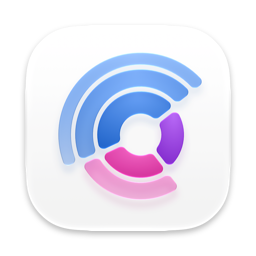
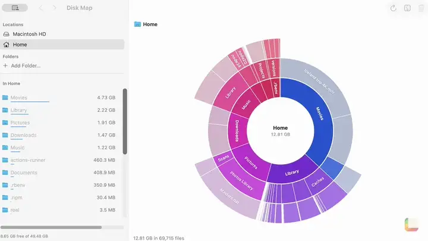

<p align="center"></p>

<h1 align="center">Disk Map</h1>

<p align="center">Shows where your disk space goes, as rings that fill in while it measures.</p>

<p align="center"><a href="https://lamp.dev/?repo=https://github.com/lampdotdev/diskmap&amp;from=readme"></a></p>

<p align="center"><a href="#build-it-yourself">Build it yourself</a></p>

<p align="center"><a href=".github/showcase/reel.mp4"></a></p>

<p align="center"><a href=".github/showcase/reel.mp4">Watch it with sound</a></p>

## Make Disk Map yours

Each opens Lamp with a copy of Disk Map and that change, ready to send:

- [Draw the map as tiles](https://lamp.dev/?repo=https://github.com/lampdotdev/diskmap&from=readme&ask=Draw%20the%20map%20as%20tiles)
- [Find big files I never open](https://lamp.dev/?repo=https://github.com/lampdotdev/diskmap&from=readme&ask=Find%20big%20files%20I%20never%20open)
- [Map where my week's hours go](https://lamp.dev/?repo=https://github.com/lampdotdev/diskmap&from=readme&ask=Map%20where%20my%20week's%20hours%20go)

## Open it in Lamp

[Lamp](https://lamp.dev) is a Mac app that builds apps from a description and changes them as you ask. [Open Disk Map in Lamp](https://lamp.dev/?repo=https://github.com/lampdotdev/diskmap&from=readme) for a copy of your own, to use and to change as you like, with the credits below kept. Or, in Lamp, choose File → Open from GitHub… and paste `https://github.com/lampdotdev/diskmap`.

## Build it yourself

With Apple's Command Line Tools installed (`xcode-select --install`):

```sh
zsh build.sh
```

The AI inside the app, and anything it does with other apps or devices, goes through Lamp, so those need Lamp open on the same Mac.

## License

MIT. See [LICENSE](LICENSE).
